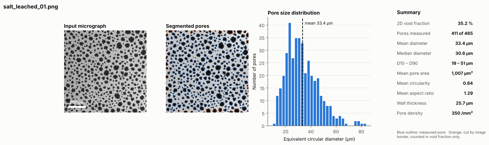
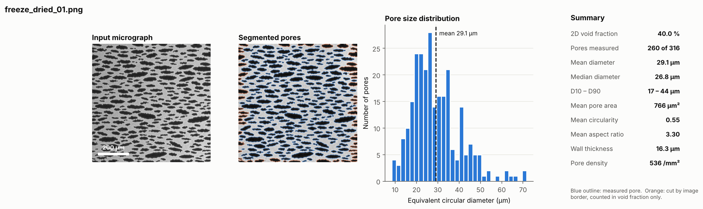
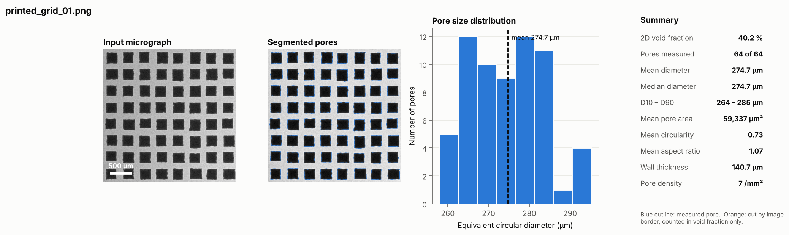
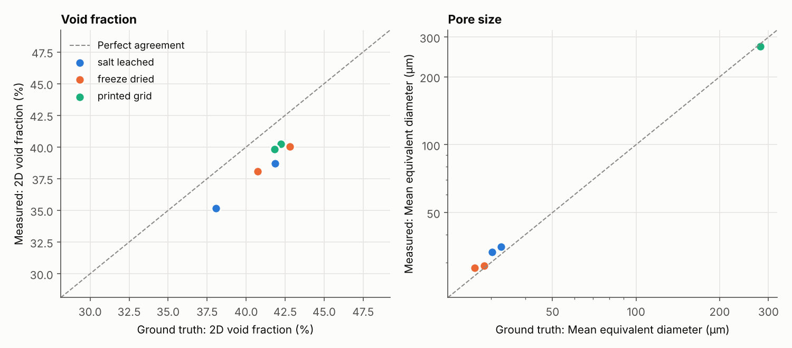

# Tissue Scaffold Porosity Analyser

**Automated measurement of pore size, pore shape and 2D void fraction from microscope images of porous biomaterial scaffolds**

*Author: Anje Heine. MSc Tissue Engineering and Biomaterials (UCL), MEng Materials Science and Engineering with Biomaterials (Imperial College London)*

---

## Why I built this

Scaffold pore architecture strongly affects tissue-engineering outcomes. Pore size controls
cell infiltration, nutrient and oxygen diffusion, vascularisation and the type of tissue that
forms. Interconnected pores of roughly 100–300 µm are often cited for bone ingrowth, and
smaller pores for soft tissue. Pores are still often measured by hand in ImageJ, which is
slow, subjective and hard to reproduce across a batch of samples.

I built this tool to help analyse scaffold micrographs in my research work. It turns SEM,
optical or micro-CT slice images into consistent, quantitative pore metrics, so scaffolds
made by different methods (porogen leaching, freeze-drying, 3D bioprinting) can be compared
objectively and quickly.

## What it measures

| Metric | Description |
|---|---|
| **2D void fraction** | pore area ÷ analysed area (areal porosity of the section) |
| **Pore size distribution** | equivalent circular diameter of every pore, with mean, median, D10 and D90 |
| Pore area, Feret diameter, major/minor axes | per pore, in calibrated µm / µm² |
| **Shape** | circularity (4πA/P²), aspect ratio, solidity, orientation, useful for spotting aligned (freeze-cast) or angular (printed) pores |
| **Wall / strut thickness** | from the medial axis of the solid phase |
| Pore density | pores per mm² |

Pores cut by the image border are counted in the void fraction but excluded from size
statistics, because their true size is unknown.

## Pipeline

```
image ─► greyscale ─► (crop SEM data bar) ─► flat-field correction ─► denoise
      ─► global threshold (Otsu / Li / triangle / Yen / manual)
      ─► morphological clean-up (remove specks, fill wall defects)
      ─► (optional watershed split of touching pores)
      ─► label & measure (scikit-image regionprops) ─► CSV / JSON / figure
```

## Example output





## Validation against ground truth

To check accuracy, `data/generate_synthetic_scaffolds.py` produces SEM-style micrographs
where every pore is known exactly. It simulates three scaffold architectures (salt-leached
sponge, aligned freeze-dried, and 3D-printed lattice) and adds realistic imaging artefacts:
wall texture, bright SEM edge rims, depth-shaded pores, uneven illumination, blur and
detector noise. `validate.py` compares the analyser's measurements with the ground truth.

<p align="center"></p>

With default settings (Otsu threshold) across all six test images:

- **Pixel-level segmentation Dice = 0.97**
- **Mean pore diameter within ~5 %** of ground truth (within 2 % for the printed lattice)
- **Void fraction within 2–3 percentage points.** There is a small, consistent underestimate:
  blur and the bright edge rim make pore boundaries look slightly smaller, so the effect is a
  real feature of SEM images. The figure is reproducible and could be corrected for.
- Measured strut thickness for the printed lattice (~141 µm) matches the designed 136 µm strut.

Threshold methods compared (`results/validation/threshold_method_comparison.csv`):

| Method | Dice | Void-fraction error (pts) | Mean-size error |
|---|---|---|---|
| **Otsu** | **0.967** | **2.6** | 5.4 % |
| Yen | 0.951 | 4.2 | 20.3 % |
| Triangle | 0.945 | 4.8 | 19.8 % |
| Li | 0.934 | 5.1 | 3.2 % |

## Quick start

```bash
git clone https://github.com/anjeheine04/scaffold-porosity-analyser.git
cd scaffold-porosity-analyser
pip install -r requirements.txt

# (optional) regenerate the synthetic test images with ground truth
python data/generate_synthetic_scaffolds.py --out data/sample_images

# analyse all sample images (calibration is read from each image's .json)
python analyse.py data/sample_images --out results

# check accuracy against ground truth
python validate.py

# run unit tests
python -m pytest -q
```

### Analysing your own micrographs

```bash
# SEM image at 0.82 µm/pixel with a 60 px information bar at the bottom
python analyse.py my_scaffold.tif --um-per-px 0.82 --crop-bottom 60

# porous foam with many touching pores: split them with a watershed
python analyse.py my_foam.png --um-per-px 2.0 --split-touching

# fluorescence / micro-CT slice where pores appear bright
python analyse.py ct_slice.tif --um-per-px 5 --bright-pores --threshold li
```

To get `--um-per-px`, measure the scale bar length in pixels (for example in ImageJ) and divide
the scale-bar value in µm by that number. Run `python analyse.py -h` for all options.

**Outputs per image** (in `--out`): `<name>_pores.csv` (one row per pore),
`<name>_summary.json`, `<name>_analysis.png` (figure above) and `<name>_pore_mask.png`.
A folder run also writes `batch_summary.csv` with one row per image, ready to compare
scaffold groups.

### Use as a Python library

```python
import sys; sys.path.insert(0, "src")
from porosity import AnalysisConfig, analyse_image

res = analyse_image("my_scaffold.png", AnalysisConfig(um_per_px=1.5, split_touching=True))
print(res.void_fraction, res.mean_equiv_diameter_um)
res.pores.head()        # pandas DataFrame of per-pore measurements
```

## Project structure

```
scaffold-porosity-analyser/
├── analyse.py                      # CLI: single image or batch folder
├── validate.py                     # accuracy vs ground truth + threshold comparison
├── src/porosity/
│   ├── analysis.py                 # preprocessing, segmentation, measurement
│   └── report.py                   # figures and file outputs
├── data/
│   ├── generate_synthetic_scaffolds.py
│   └── sample_images/              # 6 test micrographs + ground-truth masks and JSON
├── results/                        # example outputs and validation
└── tests/test_analysis.py          # pytest unit tests
```

## Skills demonstrated

Python · NumPy · SciPy (ndimage) · scikit-image (thresholding, morphology, watershed,
regionprops, medial axis) · Matplotlib · quantitative image analysis · method validation
against ground truth · CLI tool design · pytest

## Important notes and limitations

- **2D void fraction is not the same as 3D porosity.** A single section shows areal porosity.
  For isotropic structures it estimates volume porosity (Delesse principle), but it says
  nothing about interconnectivity. Analysing a micro-CT stack slice by slice is a natural
  extension.
- The included images are **synthetic**, made for validation. Real micrographs may need tuned
  thresholds, more denoising or `--split-touching`. Always check the overlay figure.
- SEM depth of field means deeper pores can show through walls. Thresholding measures the
  surface plane only.

## Next steps

- 3D analysis of micro-CT stacks (volumetric porosity, pore interconnectivity, tortuosity)
- Adaptive / machine-learning segmentation (e.g. random-forest pixel classifier or U-Net) for
  difficult, low-contrast images
- Statistical comparison between scaffold groups (ANOVA on pore-size distributions)

## License

MIT. See [LICENSE](LICENSE).
